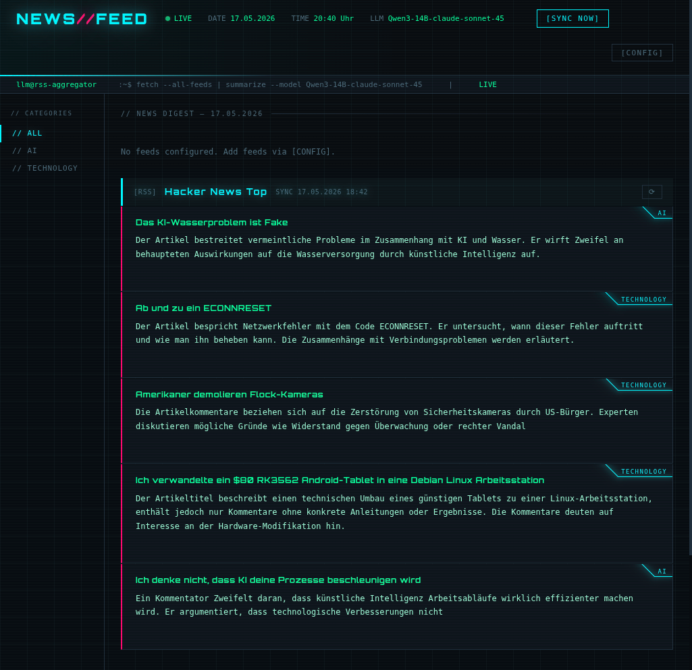

# feed-reader-llm

Experimental RSS feed aggregator that summarizes articles in different languages using a local LLM and serves the result as a self-hosted cyberpunk-styled HTML page. There are better feed reader with llm integrations, this is just a experimental way to see what i can do with a local llm.



## Features

- Fetches configured RSS feeds from a PostgreSQL database
- Summarizes each article in 2-3 sentences via a local LLM (OpenAI-compatible API)
- **Article deduplication** — summaries are stored in the DB; an article is only sent to the LLM once, identified by its URL. Re-syncing a feed skips already-known articles entirely.
- **Live block rendering** — each feed is a separate block that appears as soon as it is ready; no waiting for all feeds to complete
- **Config panel** — in-browser management of RSS sources (add, delete, enable/disable)
- **Sync Now** — triggers an immediate full refresh; reloads the page when done
- **Per-feed sync** — each block has its own sync button to refresh just that feed without touching the others
- Enable/disable a feed in the config panel instantly adds or removes its block from the main page
- **Category sidebar** — each article is automatically classified into a free-form category by the LLM (e.g. Politics, Security, Art, Finance) in the same call that produces the summary; the sidebar is built dynamically from all categories present in the database and filters the feed blocks
- **Configurable summary language** — choose the language for summaries and article titles in the CONF LLM dialog (German, English, French, Spanish, Italian, Portuguese, Dutch, Polish, Turkish); changing the language triggers a full re-translation on the next sync
- **Translated article titles** — article titles are translated into the selected language by the LLM alongside the summary; the translated title is shown in the feed blocks

## Architecture

```
┌──────────────────────────────────────────────────────┐
│  Pod                                                 │
│                                                      │
│  ┌───────────┐   /html volume   ┌──────────────┐     │
│  │  nginx    │◄────────────────►│  generator   │     │
│  │  :8080    │                  │  (60 s loop) │──┐  │
│  └────┬──────┘                  └──────────────┘  │  │
│       │ /api/ proxy                               │  │
│       ▼                                           ▼  │
│  ┌──────────────┐                  ┌────────────┐    │
│  │ api (Flask,  │◄──/html volume──►│ PostgreSQL │    │
│  │ gunicorn)    │─────────────────►│ (external) │    │
│  │ :5000        │                  └────────────┘    │
│  └──────────────┘                                    │
└──────────────────────────────────────────────────────┘
```

All app roles come from one image, `ghcr.io/movray/feed-reader-llm`; the first
argument picks the role (`app/entrypoint.sh`).

| Container | Image | Role |
|---|---|---|
| `migrate` | `ghcr.io/movray/feed-reader-llm` | Init container — waits for the database, creates or updates the schema (`app/schema.sql`) |
| `nginx` | `nginxinc/nginx-unprivileged` | Serves `index.html` shell and block files, proxies `/api/` to the API |
| `generator` | `ghcr.io/movray/feed-reader-llm` | Fetches feeds, calls LLM for new articles, writes shell and per-feed block files |
| `api` | `ghcr.io/movray/feed-reader-llm` | Flask REST API (gunicorn) for the config panel and block serving |

The image is based on `python:3.13-alpine`, runs as a non-root user and
contains no pip; every release is scanned with Trivy (no HIGH or CRITICAL
finding, unfixed ones included), signed with cosign and has build provenance.

### Render flow

The page is built from a static shell plus independent per-feed blocks:

1. `index.html` is a shell with one HTMX loading slot per enabled feed (`/html/blocks/<uuid>.html`)
2. The browser polls `/api/block/<uuid>` for each slot until the block file exists
3. The generator writes each block file as soon as that feed is processed — other feeds appear without waiting
4. Block files persist across syncs; existing content stays visible while the generator runs in the background

### Sync triggers

| Trigger | Effect |
|---|---|
| `[SYNC NOW]` button | Writes `/html/.sync-now`; generator picks it up within 60 s and processes all enabled feeds regardless of their interval; page reloads when done |
| Per-feed `⟳` button | Writes `/html/.sync-feed-<uuid>`; generator processes only that feed via `--feed <uuid>`; other blocks untouched |
| Scheduled interval | Generator checks every 60 s whether each feed's `sync_interval_minutes` has elapsed; feeds not yet due are skipped |

## Category sidebar

Each article receives a single English category word assigned by the LLM during summarization — no fixed vocabulary, the model chooses freely based on the article content. Examples: `Security`, `Politics`, `Art`, `Finance`, `Science`.

The sidebar on the left is built entirely from the categories currently present in the database. Clicking a category filters the visible feed blocks to only those that contain at least one article in that category. Clicking `// ALL` resets the filter.

### How categories are assigned

The LLM is asked to respond in a strict two-line format:

```
CATEGORY: Technology
SUMMARY: German summary of the article.
```

Both are extracted in a single API call. Articles that already have a summary but no category (e.g. after upgrading from an older version) are backfilled on the next sync using a lightweight title-only classification call.

## Article deduplication

Before calling the LLM, the generator checks the `articles` table for each article URL:

```python
cur.execute("SELECT url FROM articles WHERE url = ANY(%s)", (urls,))
existing = {row[0] for row in cur.fetchall()}
# articles whose URL is already in DB are skipped — LLM is not called
```

An article URL is the stable unique identifier. If it is already in the `articles` table the summary is reused as-is, regardless of how many times the feed is synced. The LLM is only called for genuinely new articles.

## Database

PostgreSQL database `feedconfig`. The `migrate` init container creates and updates all tables on every start (`app/schema.sql`, idempotent).

### `sources` table (active)

| Column | Type | Description |
|---|---|---|
| `id` | `SERIAL` | Primary key (integer, auto-increment) |
| `name` | `TEXT` | Display name |
| `url` | `TEXT UNIQUE` | Feed URL |
| `enabled` | `BOOLEAN` | Whether the feed is included in syncs |
| `sync_interval_minutes` | `INTEGER` | Per-feed sync interval in minutes (default 360) |
| `max_articles` | `INTEGER` | Max articles fetched per sync (default 5, range 1–20) |
| `category` | `TEXT` | Comma-separated category words derived from article categories |
| `last_fetched_at` | `TIMESTAMPTZ` | Updated after each successful fetch |

### `articles` table (active)

| Column | Type | Description |
|---|---|---|
| `id` | `UUID` | Primary key |
| `source_id` | `INTEGER` | References `sources.id` |
| `title_original` | `TEXT` | Article title from RSS |
| `url` | `TEXT UNIQUE` | Article URL — used for deduplication |
| `summary_llm` | `TEXT` | Summary generated by LLM in the configured language |
| `title_translated` | `TEXT` | Article title translated by LLM into the configured language |
| `category` | `TEXT` | Single English topic word assigned by LLM (e.g. `Security`, `Politics`, `Art`) |
| `llm_error` | `BOOLEAN` | True if LLM call failed |
| `published_at` | `TIMESTAMPTZ` | Publication date from RSS feed |
| `fetched_at` | `TIMESTAMPTZ` | When the article was stored |

### `llm_config` table

Single-row table for LLM connection settings, editable via the CONF LLM dialog.

| Column | Type | Description |
|---|---|---|
| `id` | `UUID` | Primary key |
| `url` | `TEXT` | OpenAI-compatible API base URL |
| `api_key` | `TEXT` | API key (`none` if not required) |
| `summary_language` | `TEXT` | Language for summaries and translated titles (default `German`) |
| `model` | `TEXT` | Model sent with every LLM request; empty = detect it from `/models` |

## Choosing the model

The model is set in the CONF LLM dialog; the field suggests the models the server lists under
`/models`, with their status on a llama-server in router mode. Saving tests the connection and
checks that the server knows the model.

With an empty model the generator detects one from `/models` on each run: the loaded model if the
server reports a status (llama-server router mode), otherwise the first one listed.

**llama-server router mode** (llama-server started without `-m`, serving several models): the
router starts the requested model on demand. With `--models-max 1` it unloads the running model
for it, so a fixed model makes the generator switch the router to that model on every sync where
other clients use a different one. Leave the model empty to use whatever is loaded instead.

If an LLM call fails (server unreachable, unknown model, timeout), the article is stored with
`llm_error` and summarized again on the next sync.

## Getting Started

### Prerequisites

| Requirement | Notes |
|---|---|
| Kubernetes ≥ 1.25 and Helm 3.8+ | or Docker with Compose for a local test |
| PostgreSQL | [CloudNative-PG](https://cloudnative-pg.io/) recommended; any PostgreSQL reachable from the pod works. For a test, the chart can start a small one. |
| OpenAI-compatible LLM | [Ollama](https://ollama.com/), llama.cpp server, LM Studio, or any hosted API |

### Quick test with docker compose

```bash
git clone https://github.com/movray/feed-reader-llm && cd feed-reader-llm
LLM_BASE_URL=http://host.docker.internal:11434/v1 docker compose up --build -d
# http://localhost:8080
```

This starts PostgreSQL, the migration, generator, API and nginx. `docker compose down -v`
removes everything including the database.

### Quick test on Kubernetes (built-in PostgreSQL)

```bash
helm install feedreader oci://ghcr.io/movray/charts/feed-reader-llm \
  -n feedreader --create-namespace \
  --set postgresql.enabled=true \
  --set llm.baseUrl=http://ollama.ollama.svc:11434/v1
kubectl -n feedreader port-forward svc/feedreader-feed-reader-llm 8080:80
```

The built-in PostgreSQL is a single pod with the official `postgres` image, a 1 Gi volume
and a generated password: fine for testing, not for production (no backups, no replication).

### Install with an existing PostgreSQL

Create a secret with the database credentials (or let the chart create one from
`database.user` / `database.password`):

```bash
kubectl create namespace feedreader
kubectl -n feedreader create secret generic feeduser-credentials \
  --from-literal=username=<db-user> --from-literal=password=<db-password>
```

`my-values.yaml`:

```yaml
llm:
  baseUrl: http://ollama.ollama.svc:11434/v1   # initial value, see below
  model: ""                                    # empty = use the loaded model

database:
  host: feedreader-db-cluster-rw               # e.g. the CloudNative-PG rw service
  name: feedconfig
  existingSecret: feeduser-credentials

ingress:
  enabled: true
  className: nginx
  host: news.example.com
  annotations:
    cert-manager.io/cluster-issuer: letsencrypt
  tls:
    enabled: true
```

```bash
helm install feedreader oci://ghcr.io/movray/charts/feed-reader-llm \
  --version <version> -n feedreader -f my-values.yaml
```

The database must exist; the `migrate` init container creates all tables on the first start
and updates the schema on upgrades. All options are documented in
[`charts/feed-reader-llm/values.yaml`](charts/feed-reader-llm/values.yaml).

`llm.baseUrl` and `llm.model` are written to the `llm_config` table only while it is empty.
Afterwards the `[CONF LLM]` dialog owns these settings; changing the values does not
overwrite them.

**ArgoCD**: an Application with the chart as source:

```yaml
source:
  repoURL: ghcr.io/movray/charts
  chart: feed-reader-llm
  targetRevision: <version>
  helm:
    valuesObject:
      database:
        host: feedreader-db-cluster-rw
        existingSecret: feeduser-credentials
```

### Add your first feeds

Open the page, click `[CONFIG]` in the top-right corner and add RSS feed URLs. The generator
picks them up on its next 60-second tick. To trigger an immediate sync, click `[SYNC NOW]`.

### Verify a release

Image and chart are signed with cosign (keyless) and have build provenance from GitHub:

```bash
gh attestation verify oci://ghcr.io/movray/feed-reader-llm:<version> -R movray/feed-reader-llm
gh attestation verify oci://ghcr.io/movray/charts/feed-reader-llm:<version> -R movray/feed-reader-llm

cosign verify ghcr.io/movray/feed-reader-llm:<version> \
  --certificate-identity-regexp '^https://github.com/movray/feed-reader-llm/' \
  --certificate-oidc-issuer https://token.actions.githubusercontent.com
```

`ghcr.io/movray/feed-reader-llm:edge` is built from every commit on `main` (signed, not
released).

### Environment variables

The chart sets these; they matter when running the image yourself.

| Variable | Description |
|---|---|
| `DB_HOST`, `DB_PORT`, `DB_NAME`, `DB_USER`, `DB_PASSWORD` | PostgreSQL connection |
| `LLM_BASE_URL` | OpenAI-compatible LLM base URL; written to `llm_config.url` on the first start, generator fallback if the DB is unreachable |
| `LLM_MODEL` | Model for LLM requests; written to `llm_config.model` on the first start, generator fallback if the DB is unreachable |
| `HTML_DIR` | Shared directory of generator, API and nginx (default `/html`) |
| `OUTPUT_FILE` | Page shell (default `$HTML_DIR/index.html`) |
| `GUNICORN_WORKERS`, `GUNICORN_THREADS`, `GUNICORN_TIMEOUT` | API server (defaults 2, 4, 60) |
| `DB_WAIT_SECONDS` | How long `migrate` waits for the database (default 300) |

## API endpoints

| Endpoint | Method | Description |
|---|---|---|
| `/api/sources` | GET | All sources as HTMX table rows |
| `/api/add-form` | GET | Add-source form HTML |
| `/api/add` | POST | Validates RSS URL, inserts into DB, appends block slot to main page |
| `/api/toggle` | POST | Toggles `enabled`; adds or removes block slot on main page |
| `/api/delete` | POST | Removes source from DB |
| `/api/block/<uuid>` | GET | Returns block HTML if ready, otherwise a self-polling loading placeholder |
| `/api/sync` | POST | Triggers full sync (all enabled feeds) |
| `/api/sync/<uuid>` | POST | Triggers sync for one feed; deletes its block file to force loading state |
| `/api/sync/status` | GET | Returns current global sync status badge |

## Development

See [DEVELOPER.md](DEVELOPER.md). In short: `make up` starts the stack with docker compose,
`make scan` builds the image and runs the same Trivy check as the release, `make lint` checks
the chart.
